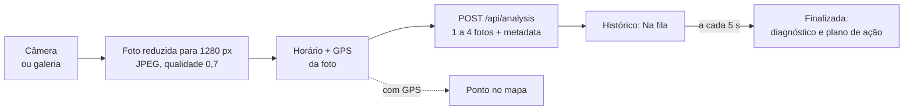

# VITA App

Aplicativo mobile do **VITA**, um sistema que identifica a **pinta preta dos citros** (*Phyllosticta citricarpa*) em fotos de tangerina Ponkan usando visão computacional.

O app é a parte do VITA que vai para o pomar. O produtor fotografa o fruto pela câmera do celular, e as fotos já saem com o horário e a localização do GPS. A análise vai para a API, e o resultado volta para o histórico com o diagnóstico e um plano de ação. As análises com localização aparecem num mapa, para ver onde a doença está aparecendo.

> Projeto Integrador da Fatec, desenvolvido pela equipe **ByteForge**. Hoje o app roda pelo **Expo Go** no Android. A classificação ainda é simulada pela API, enquanto o modelo de verdade é treinado no repositório `vita-ai`.

---

## Sumário

- [Por que o VITA existe](#por-que-o-vita-existe)
- [Onde o app entra no projeto](#onde-o-app-entra-no-projeto)
- [Tecnologias](#tecnologias)
- [Arquitetura](#arquitetura)
- [Como rodar](#como-rodar)
- [Features](#features)
- [O que aprendemos até aqui](#o-que-aprendemos-até-aqui)
- [Equipe](#equipe)

---

## Por que o VITA existe

A tangerina Ponkan é uma das culturas mais importantes do Vale do Ribeira, e boa parte da produção vem da agricultura familiar. A pinta preta é uma doença causada por fungo que mancha a casca e derruba o fruto antes da hora. Fruto manchado perde valor de venda. Além disso, as lesões podem ser confundidas com dano mecânico ou de inseto, então nem sempre o produtor tem certeza do que está vendo.

A ideia do VITA é dar ao produtor uma segunda opinião rápida: ele tira fotos do fruto, uma rede neural convolucional (CNN) classifica a imagem como **com** ou **sem** pinta preta, e o sistema sugere um plano de ação. Por isso o celular é a peça principal: é ele que está na mão do produtor, no meio da plantação.

## Onde o app entra no projeto

| Repositório | O que faz |
| --- | --- |
| **`vita-app-mobile`** (este) | App de campo: câmera, histórico, detalhes, mapa e perfil |
| Web | Painel de gestão e consulta (Next.js) |
| `vita-api` | API REST em TypeScript: usuários, análises, fila de processamento, imagens |
| `vita-ai` | Treino da CNN e o serviço de inferência que a API vai consumir |
| `vita-database` | Modelagem do banco de dados |

O app e o Web usam a mesma API e o mesmo contrato. A diferença é o uso: o Web é para consultar com calma, o app é para registrar em campo.

## Tecnologias

| Tecnologia | Para que usamos |
| --- | --- |
| [Expo SDK 58](https://expo.dev/) + React Native 0.88 | Base do app; o Expo Go permite testar no celular sem gerar APK |
| Expo Router | Rotas por arquivos (pasta `src/app`), com grupos para login e abas |
| React 19 + React Compiler | Interface; o compilador cuida da memoização |
| TypeScript | Tipagem do código e do contrato com a API |
| Axios | Chamadas HTTP, com um interceptor que envia o token e trata o 401 |
| AsyncStorage | Guarda o token e os dados do usuário no aparelho |
| Zod 4 | Validação dos formulários de login e cadastro |
| expo-camera | Câmera dentro do app |
| expo-image-picker | Escolher fotos da galeria |
| expo-image-manipulator | Reduz e comprime a foto antes do envio |
| expo-location | GPS de cada foto tirada |
| react-native-maps | Mapa das análises (Android; no navegador aparece um aviso) |
| expo-haptics, Reanimated | Vibração e animações dos botões |
| EAS Build | Gerar o APK de teste (perfil `preview`) |

## Arquitetura

### Pastas

```
src/
├── app/                    # telas (Expo Router: cada arquivo é uma rota)
│   ├── (auth)/             # login e cadastro
│   ├── (tabs)/             # abas: início, histórico, mapa e perfil
│   ├── analise/[id].tsx    # detalhes de uma análise
│   └── camera.tsx          # câmera e envio das fotos
├── services/               # chamadas à API
│   ├── api.ts              # instância do axios, token e tratamento do 401
│   ├── authService.ts      # login e cadastro
│   ├── userService.ts      # perfil (/user/me)
│   └── analysisService.ts  # upload, lista, detalhes e mapa
├── types/api.ts            # tipos do contrato da API (o mesmo arquivo do Web)
├── context/AuthContext.tsx # sessão: quem está logado, signIn e signOut
├── hooks/useAuth.ts        # atalho para usar a sessão nas telas
├── storage/                # token e usuário no AsyncStorage
├── components/             # componentes reaproveitados (linha do histórico, mapa, filtros...)
├── utils/                  # rótulos, datas, localização, preparo da imagem, mensagens de erro
├── validation/             # schemas Zod dos formulários
└── styles/                 # estilos de cada tela
```

### Como uma tela fala com a API

Seguimos uma divisão simples, inspirada no projeto base da disciplina de mobile (TaskFlow):

- **Os services fazem a chamada e devolvem `response.data`.** Se a API responder com erro, o axios lança a exceção.
- **A tela trata o erro com `try/catch`** e mostra a mensagem com o `getErrorMessage(error, "texto padrão")`. Esse helper pega a mensagem que a API mandou, ou explica que não houve conexão.

```tsx
try {
  const response = await getAnalyses(from, to);
  setAnalyses(response.data.items);
} catch (error) {
  showAlert("Erro", getErrorMessage(error, "Não foi possível carregar as análises."));
}
```

O `api.ts` também cuida da sessão. Toda requisição leva o token salvo. Se a API responder 401 numa requisição que **levou** token, o app entende que a sessão venceu e volta para o login. O login com senha errada não leva token, então mostra a mensagem na tela em vez de deslogar.

### O caminho de uma foto



- **A foto é reduzida antes do envio.** Uma foto de celular pode passar de 5 MB, que é o limite da API. Com 1280 px de largura e compressão, fica bem menor e envia mais rápido no 4G do campo.
- **Cada foto leva os próprios metadados** (`capturada_em` e `localizacao`), na mesma ordem dos arquivos. Fotos da galeria vão sem horário e sem GPS.
- **O histórico se atualiza sozinho** a cada 5 segundos enquanto houver análise na fila ou processando.

### Contrato com a API

Os tipos ficam em `src/types/api.ts`, com o mesmo conteúdo do arquivo do Web. Duas regras que vale saber:

- **Nomes dos campos:** os campos de domínio vêm em português (`criado_em`, `total_imagens`, `classificacao`). O envelope (`success`, `message`, `data`) e a paginação (`items`, `page`, `total_pages`) vêm em inglês.
- **Imagens:** a API manda uma **URL assinada** pronta, que vale por 60 minutos. A tela de detalhes busca os dados de novo sempre que volta a ficar em foco, para não mostrar uma URL vencida.

## Como rodar

### Requisitos

- Node.js 20 ou mais novo, e npm
- O app **Expo Go** no celular Android (Play Store)
- Celular e computador na **mesma rede Wi-Fi**
- A **API VITA rodando** (veja o README do `vita-api`)

### Passo a passo

1. Clone e instale:

   ```bash
   git clone <url-do-repositorio>
   cd vita-app-mobile
   npm install
   ```

2. Descubra o IP do computador na rede (`ipconfig` no Windows, `ip addr` no Linux) e crie o `.env` a partir do exemplo:

   ```bash
   cp .env.example .env
   ```

   ```bash
   # endereço da API, com /api no final, usando o IP do computador
   EXPO_PUBLIC_API_URL=http://192.168.0.10:8080/api
   ```

3. **Na API**, use o mesmo IP no `STORAGE_PUBLIC_URL` e reinicie a API. Sem isso, as fotos não carregam no celular:

   ```bash
   STORAGE_PUBLIC_URL=http://192.168.0.10:8080/api/files
   ```

4. Suba o app e leia o QR Code com o Expo Go:

   ```bash
   npx expo start -c
   ```

   O `-c` limpa o cache. Ele é necessário sempre que o `.env` muda, porque as variáveis `EXPO_PUBLIC_` entram no app na hora do build.

5. Entre com um usuário do seed da API:

   | E-mail | Senha |
   | --- | --- |
   | `produtor@vita.dev` | `senha123` |
   | `estudante@vita.dev` | `senha123` |

### Scripts

| Comando | O que faz |
| --- | --- |
| `npm start` | Inicia o Expo (QR Code para o Expo Go) |
| `npm run android` | Inicia e abre no emulador ou no celular conectado |
| `npm run web` | Abre no navegador (o mapa mostra só um aviso) |
| `npm run lint` | Roda o ESLint do Expo |
| `eas build -p android --profile preview` | Gera um APK de teste pelo EAS |

### Problemas que já tivemos

- **"Sem conexão com a API".** Quase sempre é o IP: no celular, `localhost` é o próprio aparelho. Confira o `EXPO_PUBLIC_API_URL`, se o celular está no mesmo Wi-Fi e se o firewall do computador libera a porta 8080. Depois de mudar o `.env`, rode `npx expo start -c`.
- **As fotos das análises não aparecem.** O `STORAGE_PUBLIC_URL` da API está com `localhost`, ou com um IP antigo. O IP muda quando você troca de rede.
- **Rodando no navegador, tudo dá erro de CORS.** A API precisa de `URL_EXPO=http://localhost:8081` no `.env` dela.
- **Abriu direto no login depois de atualizar o app.** É esperado uma vez: o formato do usuário salvo no aparelho mudou, e o app pede login de novo.

## Features

### Funcionando com a API

- [x] Cadastro em etapas, com escolha de perfil (produtor ou estudante) e validação igual à da API
- [x] Login, logout e sessão salva no aparelho; logout automático quando o token vence
- [x] Início com resumo do mês: fotos enviadas e pintas pretas detectadas
- [x] Câmera com até 4 fotos por análise (a partir de 1), também da galeria, com horário e GPS em cada foto
- [x] Histórico por dia, com abas "Em andamento" e "Finalizadas" e atualização automática
- [x] Detalhes da análise: fotos, diagnóstico, confiança, modelo e plano de ação para fruto saudável ou com pinta preta
- [x] Mapa das análises com filtros de período, status e classe
- [x] Perfil com os dados da conta

## Equipe

**ByteForge**: Arthur Parra, Danieli Fiel, Guilherme Pereira, Gustavo Kletelinger e Matheus Oliveira.

Faculdade de Tecnologia do Estado de São Paulo (Fatec).
